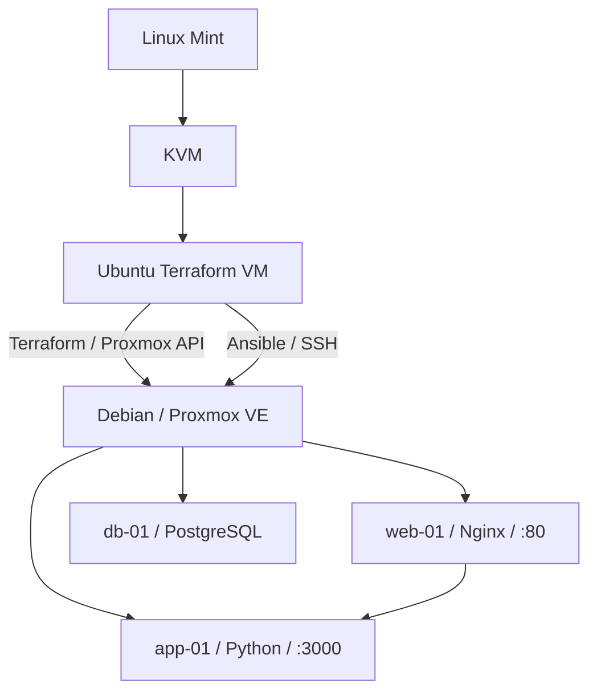
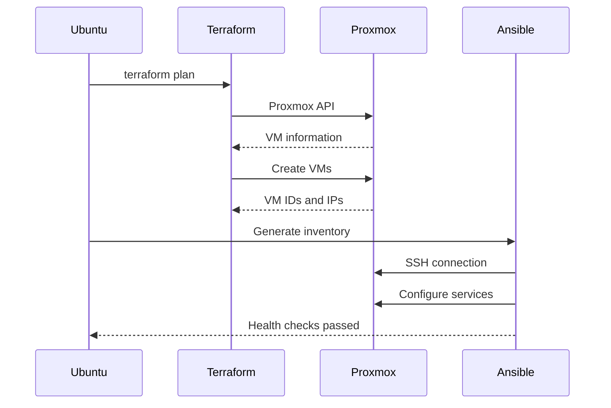
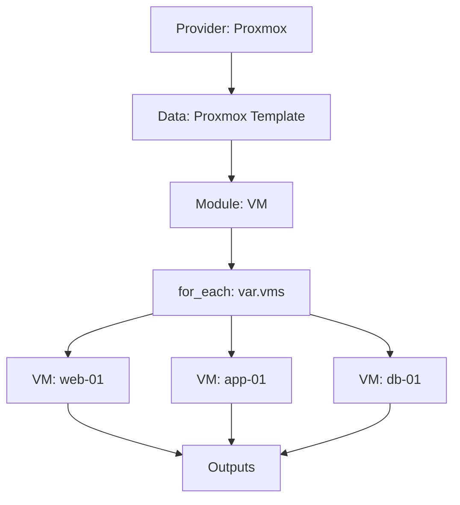

# Proxmox Infrastructure Automation

Infrastructure as Code (IaC) project for automated provisioning and configuration of virtual machines on Proxmox VE using Terraform and Ansible.

The project creates a small multi-tier infrastructure consisting of a PostgreSQL database server, a Python application server, and an Nginx reverse proxy.

Terraform manages the infrastructure lifecycle, while Ansible handles operating system configuration and application deployment.

## Architecture



## Infrastructure components

VM | Role | Software | IP address
--- | --- | ---  | ---
web-01 | Reverse proxy | Nginx | 192.168.122.201
app-01 | Application server | Python 3 | 192.168.122.202
db-01 | Database server | PostgreSQL | 192.168.122.203

## Technology stack

- **Hypervisor:** Proxmox VE
- **Virtualization:** KVM
- **Infrastructure provisioning:** Terraform
- **Terraform provider:** bpg/proxmox
- **Configuration management:** Ansible
- **Operating system:** Debian
- **Controller:** Ubuntu Server (Terraform + Ansible).
- **Hypervisor:** Proxmox VE.
- **Guest VMs:** Debian cloud-init template.
- **Reverse proxy:** Nginx
- **Application:** Python 3
- **Database:** PostgreSQL
- **Remote access:** SSH with public key authentication

## Project Structure

```text
.
├── ansible/
│   ├── ansible.cfg
│   ├── group_vars/
│   ├── inventory/
│   ├── playbooks/
│   │   ├── healthcheck.yml
│   │   └── site.yml
│   └── roles/
│       ├── application/
│       ├── database/
│       └── reverse_proxy/
│
├── modules/
│   └── vm/
│       ├── main.tf
│       ├── variables.tf
│       ├── outputs.tf
│       └── versions.tf
│
├── scripts/
│   ├── configure.sh
│   ├── deploy.sh
│   ├── generate_inventory.py
│   ├── generate_known_hosts.py
│   ├── prepare_ssh.sh
│   ├── provision.sh
│   └── update_infrastructure.sh
│
├── tests/
│   └── network.tftest.hcl
│
├── data.tf
├── locals.tf
├── main.tf
├── outputs.tf
├── providers.tf
├── variables.tf
├── versions.tf
├── terraform.tfvars.example
└── README.md
```

## Prerequisites

Before using this project, make sure you have:

- A working Proxmox VE installation.
- A Debian cloud-init VM template available in Proxmox.
- An API token with sufficient permissions to manage virtual machines.
- A configured Proxmox network bridge and datastore.
- Terraform >= 1.9.0.
- Ansible installed on the Terraform controller.
- Python 3.
- OpenSSH client utilities.
- An SSH key pair.

## Configuration

### 1. Configure Proxmox API access

Create a directory for your Proxmox API token:

```bash
mkdir -p ~/.config/proxmox-lab
chmod 700 ~/.config/proxmox-lab
```

Store your API token in:

```text
~/.config/proxmox-lab/api-token
```

Alternatively, provide the token through an environment variable:

```bash
export TF_VAR_proxmox_api_token="USER@REALM!TOKENID=SECRET"
```

### 2. Configure SSH authentication

Generate an SSH key pair if you do not already have one:

```bash
ssh-keygen -t ed25519
```

The default key paths used by this project are:

```text
~/.ssh/id_ed25519
~/.ssh/id_ed25519.pub
```

The public key is injected into virtual machines through cloud-init.

The private key is used by Ansible to establish SSH connections.

### 3. Configure Terraform variables

Create your local configuration:

```bash
cp terraform.tfvars.example terraform.tfvars
```

Edit `terraform.tfvars` according to your Proxmox environment.

Example:

```hcl
proxmox_endpoint = "https://192.168.122.105:8006/"

proxmox_node = "pve"
template_id  = 9000

vm_username         = "s-debi"
ssh_public_key_path = "~/.ssh/id_ed25519.pub"

network_bridge = "vmbr0"
datastore_id   = "local-lvm"

network_cidr = "192.168.122.0/24"
gateway      = "192.168.122.1"
```

Configure virtual machines in the vms map:

```hcl
vms = {
  web-01 = {
    cores  = 2
    memory = 1024
    disk   = 5
    ip     = "192.168.122.201/24"
  }

  app-01 = {
    cores  = 2
    memory = 2048
    disk   = 6
    ip     = "192.168.122.202/24"
  }

  db-01 = {
    cores  = 1
    memory = 2048
    disk   = 7
    ip     = "192.168.122.203/24"
  }
}
```

### Deployment Workflow



### Terraform Design



### Deployment

The project provides a single deployment script:

```bash
./scripts/deploy.sh
```

The script performs three stages.

**Stage 1: Infrastructure provisioning**

```bash
./scripts/provision.sh
```

This stage:

- Initializes Terraform.
- Formats and validates the configuration.
- Generates an execution plan.
- Applies the plan to Proxmox.
- Creates virtual machines from the specified template.

**Stage 2: SSH preparation**

```bash
./scripts/prepare_ssh.sh
```

This stage:

- Generates an Ansible inventory using Terraform outputs.
- Waits for SSH services to become available.
- Retrieves SSH host keys.
- Checks existing host keys against newly discovered keys.
- Updates ~/.ssh/known_hosts.

**Stage 3: Configuration management**

```bash
./scripts/configure.sh
```

Ansible configures the virtual machines using dedicated roles:

- database — installs and starts PostgreSQL.
- application — deploys the Python application and creates a systemd service.
- reverse_proxy — installs Nginx and configures reverse proxying.

After configuration, health checks verify service availability and application responses.

### Terraform Validation and Testing

Validate the Terraform configuration:

```bash
terraform init
terraform fmt -recursive
terraform validate
```

Run infrastructure tests:

```bash
terraform test
```

The test suite uses a mocked Proxmox provider and checks:

- Valid infrastructure configuration.
- Duplicate IP addresses.
- Invalid IP addresses.
- Incorrect network prefixes.
- IP addresses outside the configured subnet.
- Gateway validation.
- Network and broadcast address restrictions.
- Empty VM configurations.

### Updating Infrastructure

To apply infrastructure changes:

```bash
./scripts/update_infrastructure.sh
```

Terraform compares the current state with the desired configuration and applies the required changes.

### Health Checks

Run Ansible health checks independently:

```bash
cd ansible
ansible-playbook playbooks/healthcheck.yml
```

The checks cover:

- PostgreSQL service status and readiness.
- Python application service status.
- Application HTTP response.
- Nginx service status and configuration.
- Application accessibility through Nginx.

### Security Considerations

- API tokens and private SSH keys are stored outside the repository.
- Sensitive Terraform variables are marked accordingly.
- SSH public key authentication is used for VM access.
- SSH host key checking is enabled in Ansible.
- Existing SSH host key changes cause deployment to stop.
- Initial SSH host key registration uses ssh-keyscan, which does not independently authenticate the server. Verify fingerprints through a trusted channel before accepting new keys.
- Local Terraform state and variable files are excluded from Git.

### SSH Host Key Verification

The project uses SSH host key verification to protect connections between the Terraform controller and provisioned virtual machines.

- Each VM has its own SSH host keys.
- SSH host keys are stored in ~/.ssh/known_hosts.
- Ansible host key checking is enabled.
- If a previously registered host key changes, the deployment process stops.
- Initial host key collection is performed using ssh-keyscan.

**Security note:** ssh-keyscan retrieves SSH host keys but does not authenticate the server. Initial fingerprints should be verified through a trusted channel before accepting them.

### Learning Objectives

This project is intended as a practical learning environment for:

- Infrastructure as Code principles.
- Terraform modules and reusable configurations.
- for_each, maps, objects, locals, and outputs.
- Terraform variable validation.
- Terraform lifecycle and dependency management.
- Proxmox API integration.
- Cloud-init provisioning.
- Terraform testing and mocked providers.
- Ansible inventories, playbooks, and roles.
- SSH authentication and host key verification.
- Multi-tier infrastructure deployment.

### License

This project is intended for educational purposes.

